# 1. Executive Summary

We want a distributed, edge-first system where:

1. **Hundreds of edge nodes** receive patient data:
   - text notes
   - photos
   - scanned documents
   - possibly forms, PDFs, reports, or clinical messages
2. Each edge node runs strong local LLM/VLM workloads on GPUs, for example:
   - **Muse Glimmer**
   - **Gemma 4 31B**
   - **Qwen 3.8 27B**
3. An **agentic workflow** parses the raw data into:
   - structured clinical entities
   - conditions
   - findings
   - observations
   - medications, allergies, procedures, etc.
   - provenance / evidence
4. Everything is converted into a **canonical schema** and stored as vectors in a local edge vector DB.
5. All edge nodes eventually sync to a **main / central node**.
6. The central node merges everything into a **single longitudinal patient document/view**, still broken into chunks if needed, but always using the same schema.
7. The final system should support:
   - semantic search
   - condition search
   - evidence retrieval
   - patient-scoped RAG
   - auditability
   - offline edge operation
   - conflict resolution
   - multi-node merge without duplicate chaos

---

# 2. Assumptions

These assumptions matter because healthcare data is sensitive and messy.

## 2.1 Data assumptions

- Patient data may include:
  - free-text clinical notes
  - intake forms
  - photos of skin, wounds, prescriptions, reports, etc.
  - scanned PDFs
  - possibly structured exports from local systems
- Raw patient identity should be minimized. 
- Edge nodes should pseudonymize patient references before central sync unless you have explicit legal approval to centralize identifiers.
- Photos may contain faces or identifiers, so redaction/de-identification should be applied where possible.

## 2.2 Infrastructure assumptions

- You have many edge nodes, possibly hundreds.
- Each edge node has GPU capacity capable of running 27B to 31B class models.
- Edge nodes may have intermittent connectivity.
- The main node is a trusted central aggregation point.
- Central node stores merged vector knowledge, metadata, and longitudinal documents.

## 2.3 Model assumptions

You mentioned three possible parsing models:

- **Muse Glimmer**
- **Gemma 4 31B**
- **Qwen 3.8 27B**

This design assumes you can route work to one or more of them depending on:

- modality: text-only vs image + text
- complexity: short note vs long clinical narrative
- risk: high-risk condition extraction vs simple administrative text
- latency: real-time vs batch
- GPU availability at the edge node

---

# 3. Product Requirements Document, PRD

## 3.1 Product name placeholder

**Edge Patient Knowledge Vectorization Platform**

You can rename this internally.

---

## 3.2 Problem statement

Healthcare data is scattered across many physical locations and formats. Patient information arrives as text, photos, scanned documents, and notes. This data is hard to search, hard to merge, and hard to use for AI-assisted workflows.

We need a distributed system that:

- processes patient data locally at edge nodes,
- uses strong local models to extract structured meaning,
- creates a normalized vector knowledge base,
- syncs from many nodes to a central node,
- merges all node outputs into a consistent longitudinal patient knowledge document,
- preserves provenance and evidence,
- avoids duplication and unsafe hallucinations.

---

## 3.3 Goals

The system must:

1. Ingest multimodal patient data at edge nodes.
2. Run agentic parsing workflows locally using 27B to 31B class models.
3. Extract structured clinical entities with evidence.
4. Convert extracted knowledge into vector-ready canonical records.
5. Store vectorized chunks and entity records locally.
6. Sync encrypted, signed, idempotent updates to a main node.
7. Merge updates from hundreds of edge nodes into one patient-scoped knowledge base.
8. Produce a merged longitudinal patient document in the same schema.
9. Support retrieval for RAG, condition search, and evidence lookup.
10. Maintain auditability from every vector back to source evidence.

---

## 3.4 Non-goals

The system is not initially trying to:

1. Replace the official EHR/EMR.
2. Provide autonomous diagnosis without human review.
3. Store raw patient identifiers centrally unless approved.
4. Train models on patient data by default.
5. Allow free-form model outputs without schema validation.
6. Merge records across patients using unsafe probabilistic matching without governance.

---

## 3.5 Users

| User | Need |
|---|---|
| Clinician | Search patient conditions, findings, notes, and evidence quickly |
| Operations staff | Monitor edge node sync health and failures |
| Data engineer | Maintain schema, pipelines, and vector indexes |
| Compliance officer | Verify consent, access control, audit trail, and data minimization |
| AI engineer | Evaluate extraction quality and model routing |
| Human reviewer | Review low-confidence or conflicting extractions |

---

## 3.6 Functional requirements

### Ingestion

| ID | Requirement |
|---|---|
| FR-1 | System accepts text, PDF, photos, scanned documents, and optionally structured clinical messages |
| FR-2 | System validates file type, size, checksum, and consent flag |
| FR-3 | System strips dangerous or unnecessary metadata, for example EXIF where appropriate |
| FR-4 | System quarantines unsupported or unauthorized files |

### Privacy and consent

| ID | Requirement |
|---|---|
| FR-5 | Every document must carry consent scope and permitted use |
| FR-6 | Patient identifiers are pseudonymized at edge before central sync |
| FR-7 | Redaction is applied for faces, IDs, phone numbers, and other direct identifiers where required |
| FR-8 | Every vector record must carry consent and tenant metadata |

### Agentic parsing

| ID | Requirement |
|---|---|
| FR-9 | An agentic workflow parses raw artifacts into structured JSON |
| FR-10 | The workflow supports model routing among Muse Glimmer, Gemma 4 31B, and Qwen 3.8 27B |
| FR-11 | Extracted entities must include evidence spans or image regions where possible |
| FR-12 | Extraction output must be schema-validated |
| FR-13 | Low-confidence output goes to human review |
| FR-14 | The workflow must support retry and repair loops |

### Vectorization

| ID | Requirement |
|---|---|
| FR-15 | Text chunks are embedded into vector format |
| FR-16 | Condition summaries and entity summaries are embedded |
| FR-17 | Image-derived findings can be embedded using vision embeddings |
| FR-18 | Every vector record includes schema version, model version, node ID, and provenance |

### Edge storage

| ID | Requirement |
|---|---|
| FR-19 | Each edge node maintains a local vector store |
| FR-20 | Each edge node maintains an outbox for sync events |
| FR-21 | Local node can continue operating during network outage |

### Sync and merge

| ID | Requirement |
|---|---|
| FR-22 | Edge nodes sync signed, encrypted batches to main node |
| FR-23 | Sync is idempotent using event IDs and content hashes |
| FR-24 | Central node merges records by pseudonymous patient reference |
| FR-25 | Central node detects duplicate and conflicting records |
| FR-26 | Central node builds a merged longitudinal patient document |
| FR-27 | Merged document is chunked using the same schema as source chunks |

### Query and retrieval

| ID | Requirement |
|---|---|
| FR-28 | Authorized users can search by patient scope, condition, modality, date, node, and document type |
| FR-29 | Vector search must support metadata filtering |
| FR-30 | Retrieved chunks must include provenance and confidence |
| FR-31 | RAG answers must cite source chunks and must not invent facts |

---

## 3.7 Non-functional requirements

| Category | Requirement |
|---|---|
| Security | mTLS, signed batches, encryption at rest, RBAC, audit logs |
| Privacy | Pseudonymization, consent scopes, data minimization |
| Reliability | Store-and-forward sync, dead-letter queues, retries |
| Scalability | Support hundreds of edge nodes and millions of vector chunks |
| Determinism | Schema-first outputs, versioned prompts, model version tracking |
| Observability | Trace ID from ingestion to vector DB to central merge |
| Compliance | Human review, retention controls, deletion workflow |
| Performance | Batch processing at edge, incremental sync, compressed payloads |
| Quality | Golden-set regression tests for extraction and merge |

---

## 3.8 Success metrics

| Metric | Target |
|---|---|
| Schema validation success rate | > 99.5% |
| Extraction with valid evidence | > 95% on golden set |
| Human review rate | < 5% to 10% initially |
| Sync success after reconnect | 100% of queued events |
| Duplicate chunk rate | Near zero due to content hashing |
| Vector search p95 latency | Depends on scale, but target sub-second for filtered search |
| Central merge idempotency | 100% |
| Audit completeness | Every vector has source provenance |

---

## 3.9 Risks and mitigations

| Risk | Mitigation |
|---|---|
| Model hallucination | Evidence-grounded extraction, schema validation, QA critic, human review |
| Patient identity mismatch | Conservative pseudonymization, explicit matching rules, human review for uncertain merges |
| PHI leakage | Redaction, pseudonymization, encrypted sync, access-controlled vector DB |
| Edge node offline | Local queue/outbox and store-and-forward |
| Schema drift | Schema registry and versioning |
| Vector DB overload | Chunking policy, dedupe, quantization, retention policies |
| Conflicting clinical facts | Preserve evidence, do not silently overwrite, conflict review workflow |
| Prompt injection from scanned docs | Treat document text as data, not instructions; output schema only |

---

# 4. High-Level System Architecture

This is the end-to-end architecture.

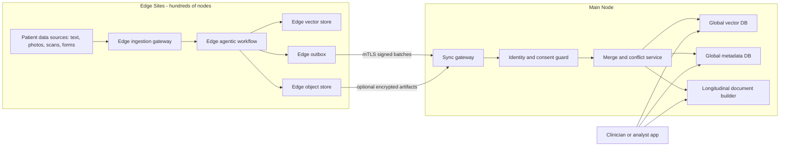

---

## 4.1 Main components

### Edge side

| Component | Responsibility |
|---|---|
| Edge ingestion gateway | Receives raw files and messages |
| Consent and privacy guard | Checks consent, redacts, pseudonymizes |
| Preprocessor | OCR, image normalization, text cleanup |
| Agentic workflow engine | Runs planner, extractor, validator, normalizer, QA |
| Model router | Chooses Muse Glimmer, Gemma 4 31B, or Qwen 3.8 27B |
| Edge vector store | Local semantic index |
| Edge object store | Optional local encrypted artifact storage |
| Edge outbox | Queues sync events for central node |

### Central side

| Component | Responsibility |
|---|---|
| Sync gateway | Receives edge batches |
| Identity and consent guard | Verifies patient scope and consent |
| Merge and conflict service | Deduplicates, merges, resolves conflicts |
| Global vector DB | Central semantic search index |
| Global metadata DB | Structured entity, audit, and relationship data |
| Longitudinal document builder | Builds merged patient document/view |

---

# 5. Edge Node Architecture

Each edge node is a mini processing plant.

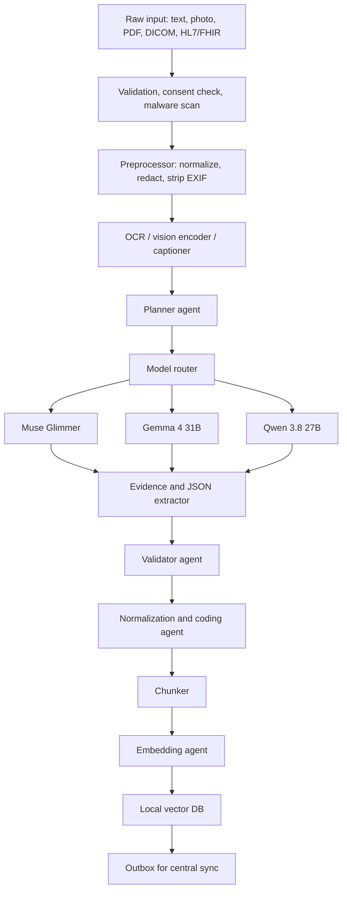

---

## 5.1 Edge node hardware assumptions

For 27B to 31B models:

| Setup | Notes |
|---|---|
| 1x large GPU, e.g. 80GB class | Can run many 30B-class models depending on precision and context |
| 2x mid-size GPUs | Possible with sharding or quantization |
| Quantized deployment | Useful for edge cost, but must be validated for clinical extraction quality |
| Continuous batching | Needed for throughput |
| Local NVMe | Needed for queue, artifacts, and vector index |

Important: if you are doing production clinical extraction, do not choose quantization only for cost. You need quality regression tests.

---

# 6. Agentic Workflow Architecture

This is the core of your request.

The workflow should not be a single prompt. It should be a multi-agent pipeline with validation and repair loops.

---

## 6.1 Agent roles

| Agent | Responsibility |
|---|---|
| Intake agent | Creates run envelope, trace ID, source metadata |
| Consent agent | Checks consent scope and allowed processing |
| Redaction agent | Masks identifiers where needed |
| Perception agent | OCR, image captioning, region detection |
| Planner agent | Decides extraction strategy |
| Model router | Selects one or more LLM/VLM models |
| Extractor agent | Produces structured JSON with evidence |
| Normalizer agent | Maps entities to canonical codes and units |
| Validator agent | Validates schema, ranges, plausibility |
| QA critic agent | Checks hallucination, missing evidence, contradictions |
| Entity resolution agent | Links conditions, medications, findings across documents |
| Chunker agent | Creates retrieval-ready chunks |
| Embedding agent | Generates vector embeddings |
| Sync agent | Writes to outbox and central sync queue |
| Human review agent | Handles low-confidence or high-risk cases |

---

## 6.2 Model routing strategy

You have three candidate models:

- Muse Glimmer
- Gemma 4 31B
- Qwen 3.8 27B

A good routing policy:

| Model | Best for | Use when |
|---|---|---|
| Muse Glimmer | Complex clinical narratives, long documents, high-risk extraction | Discharge summaries, complex history, multi-condition reasoning |
| Gemma 4 31B | High-volume structured text, forms, short notes | Intake forms, simple clinical notes, administrative text |
| Qwen 3.8 27B | Multimodal image + text workflows | Photos, scanned pages, images with captions or OCR |

You can also use an ensemble pattern:

- Primary model extracts.
- Secondary model verifies high-risk fields.
- If disagreement, send to human review.

---

## 6.3 Routing signals

The router can decide using:

| Signal | Example |
|---|---|
| Modality | text, image, PDF, structured form |
| Length | short note vs multi-page document |
| Clinical density | many medical terms, meds, conditions |
| Risk level | diagnosis, medication, allergy, oncology, cardiology |
| Language | English, multilingual, mixed |
| GPU load | current queue depth at edge node |
| Latency class | real-time vs batch |
| Consent scope | whether central sync or model ensemble is allowed |

Example routing policy:

```text
if image_present:
    prefer Qwen 3.8 27B
elif document_length > long_threshold:
    prefer Muse Glimmer
elif high_risk_clinical_section:
    prefer Muse Glimmer + critic model
else:
    prefer Gemma 4 31B
```

---

# 7. Detailed Agentic Workflow

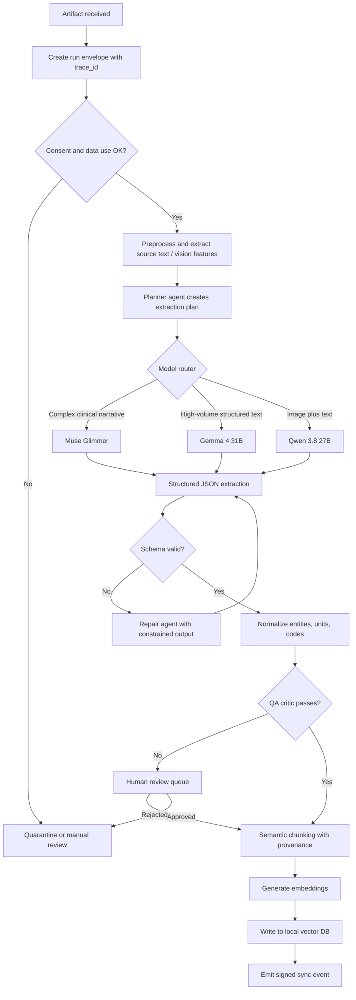

---

## 7.1 Step-by-step workflow

### Step 1: Ingestion

Input arrives:

- text note
- photo
- scanned PDF
- form
- structured message

System creates:

```json
{
  "run_id": "run_123",
  "node_id": "node_45",
  "trace_id": "trace_abc",
  "artifact_type": "photo",
  "received_at": "2026-01-01T10:00:00Z",
  "consent_scope": "clinical_care_internal",
  "patient_local_ref": "local_patient_987"
}
```

---

### Step 2: Consent and privacy check

The consent agent checks:

- Is processing allowed?
- Is central sync allowed?
- Is research use allowed?
- Are images allowed?
- Should raw artifacts remain edge-only?

If not allowed, the artifact is quarantined.

---

### Step 3: Preprocessing

For text:

- normalize encoding
- detect language
- remove unsafe instructions
- detect document sections

For images:

- strip EXIF
- detect face and redact if needed
- enhance quality
- run OCR if document-like
- generate visual caption or features

For PDFs:

- extract text
- detect tables
- detect page and bounding boxes
- preserve page provenance

---

### Step 4: Planner agent

The planner creates an extraction plan:

```json
{
  "doc_type": "clinical_note",
  "sections_detected": [
    "history_of_present_illness",
    "medications",
    "assessment",
    "plan"
  ],
  "extraction_targets": [
    "conditions",
    "medications",
    "allergies",
    "observations",
    "procedures"
  ],
  "model_route": "muse_glimmer",
  "risk_level": "high"
}
```

---

### Step 5: Model execution

The selected model receives:

- extracted text or image features
- strict JSON schema
- extraction instructions
- evidence requirements
- no-hallucination rules

The model must return structured JSON only.

---

## 7.2 Example model instruction contract

Use a strict prompt contract like:

```text
You are a clinical information extraction agent.

Rules:
1. Return JSON only.
2. Follow the provided schema exactly.
3. Extract only information present in the source.
4. Do not invent missing data.
5. If unknown, use null.
6. Every clinical assertion must have evidence.
7. For text, provide source_span.
8. For image, provide source_region.
9. Include confidence for each extracted item.
10. Do not provide diagnosis or medical advice.
```

---

## 7.3 Example extraction output

```json
{
  "schema_version": "1.0.0",
  "doc_id": "doc_123",
  "patient_ref_id": "pseudonym_abc",
  "language": "en",
  "conditions": [
    {
      "display": "Type 2 diabetes mellitus",
      "code": "E11.9",
      "code_system": "ICD-10",
      "status": "active",
      "certainty": 0.92,
      "onset": null,
      "evidence": [
        {
          "source_type": "text",
          "source_span": "Patient has a history of type 2 diabetes.",
          "page": null,
          "bbox": null
        }
      ]
    }
  ],
  "medications": [
    {
      "display": "Metformin",
      "dose": "500 mg",
      "frequency": "twice daily",
      "route": "oral",
      "status": "active",
      "certainty": 0.95,
      "evidence": [
        {
          "source_type": "text",
          "source_span": "Currently taking metformin 500 mg twice daily.",
          "page": null,
          "bbox": null
        }
      ]
    }
  ],
  "observations": [],
  "allergies": [],
  "procedures": []
}
```

---

## 7.4 Processing sequence with model router

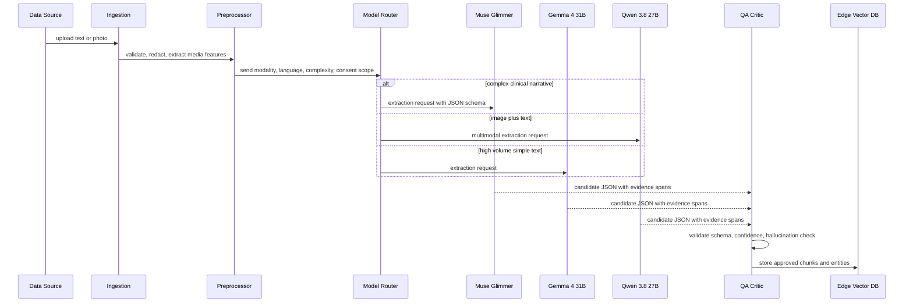

---

# 8. Validation, QA, and Human Review

Do not trust raw model output directly.

## 8.1 Validator agent checks

- JSON schema validity
- required fields present
- dates valid
- codes valid
- units normalized
- confidence present
- evidence present
- no impossible values
- no contradictions

Examples:

| Check | Example |
|---|---|
| Required field | `condition.display` exists |
| Code validation | ICD-10/SNOMED code format |
| Date sanity | onset date not in future |
 Dosage sanity | dose not absurdly high without flag |
| Evidence check | condition has source span |
| Hallucination check | extracted fact not present in source text |

---

## 8.2 QA critic agent

The critic can be another model or rules engine.

It checks:

- Is the evidence strong enough?
- Is the confidence calibrated?
- Are multiple models disagreeing?
- Is the item clinically high-risk?
- Does the extraction conflict with prior patient knowledge?

If QA fails:

- send to human review
- mark record as low confidence
- do not sync as final clinical truth

---

## 8.3 Human review triggers

Send to human review if:

- confidence below threshold
- high-risk condition
- conflicting status: active vs resolved
- medication dosage unclear
- allergy extraction uncertain
- identity matching uncertain
- image finding ambiguous
- multiple models disagree

---

# 9. Canonical Schema for Vector DB

You need one canonical schema across all nodes.

Do not let each edge node create its own free-form schema.

---

## 9.1 Core entities

| Entity | Meaning |
|---|---|
| PatientRef | Pseudonymous patient reference |
| Document | Source document or artifact |
| Chunk | Retrieval chunk with embedding |
| Condition | Extracted condition |
| Finding | Image or report finding |
| Observation | Measurement, lab, vital, symptom |
| Medication | Drug, dose, frequency |
| Allergy | Allergy or intolerance |
| Procedure | Procedure or intervention |
| Evidence | Source span, page, bbox, artifact reference |

---

## 9.2 Entity model diagram

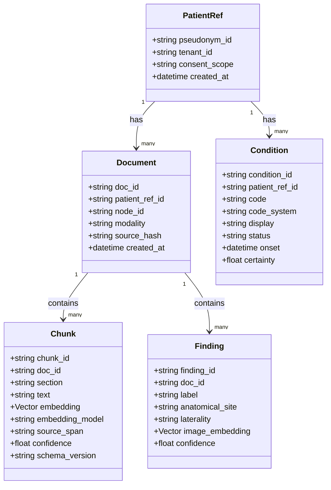

---

## 9.3 Relationship diagram

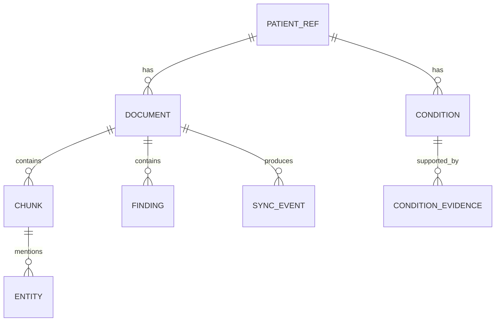

---

# 10. Recommended Vector DB Collections

You can implement this in Qdrant, Milvus, Weaviate, pgvector, OpenSearch, or another vector-capable store.

The important thing is the logical schema.

---

## 10.1 Collection: `doc_chunks`

Purpose: semantic retrieval over document chunks.

Fields:

```json
{
  "chunk_id": "doc_123::chunk_001",
  "doc_id": "doc_123",
  "patient_ref_id": "pseudonym_abc",
  "tenant_id": "tenant_1",
  "node_id": "node_45",
  "section": "history_of_present_illness",
  "modality": "text",
  "language": "en",
  "text": "Patient reports fatigue for two weeks.",
  "embedding_model": "text-embed-v1",
  "embedding_dim": 1024,
  "source_span": "page=1,chars=120-220",
  "confidence": 0.93,
  "schema_version": "1.0.0",
  "content_hash": "sha256:...",
  "created_at": "2026-01-01T10:00:00Z",
  "status": "active"
}
```

Indexing:

- vector index on `embedding`
- metadata filters on:
  - `patient_ref_id`
  - `tenant_id`
  - `node_id`
  - `modality`
  - `section`
  - `schema_version`
  - `status`
  - `created_at`

---

## 10.2 Collection: `condition_entities`

Purpose: condition-level search and merge.

```json
{
  "condition_id": "cond_567",
  "patient_ref_id": "pseudonym_abc",
  "tenant_id": "tenant_1",
  "display": "Type 2 diabetes mellitus",
  "code": "E11.9",
  "code_system": "ICD-10",
  "status": "active",
  "certainty": 0.92,
  "onset": null,
  "first_seen_doc_id": "doc_123",
  "last_seen_doc_id": "doc_123",
  "evidence_chunk_ids": [
    "doc_123::chunk_002"
  ],
  "embedding_model": "condition-embed-v1",
  "schema_version": "1.0.0",
  "updated_at": "2026-01-01T10:00:00Z"
}
```

Embedding source:

```text
Type 2 diabetes mellitus, active, certainty high, evidence from node_45 document doc_123
```

---

## 10.3 Collection: `image_findings`

Purpose: image-derived findings.

```json
{
  "finding_id": "find_890",
  "doc_id": "doc_456",
  "patient_ref_id": "pseudonym_abc",
  "tenant_id": "tenant_1",
  "node_id": "node_45",
  "label": "erythematous rash",
  "anatomical_site": "left forearm",
  "laterality": "left",
  "severity": null,
  "image_region": {
    "bbox": [0.21, 0.35, 0.64, 0.78],
    "page": null
  },
  "caption": "Photo shows red patch on left forearm.",
  "confidence": 0.83,
  "embedding_model": "vision-embed-v1",
  "schema_version": "1.0.0",
  "created_at": "2026-01-01T10:05:00Z"
}
```

---

## 10.4 Collection: `observation_entities`

For labs, vitals, symptoms, measurements.

```json
{
  "observation_id": "obs_123",
  "patient_ref_id": "pseudonym_abc",
  "type": "blood_pressure",
  "value": "138/88",
  "unit": "mmHg",
  "status": "final",
  "effective_at": "2026-01-01T09:40:00Z",
  "certainty": 0.97,
  "evidence_chunk_ids": [
    "doc_123::chunk_004"
  ],
  "schema_version": "1.0.0"
}
```

---

## 10.5 Collection: `medication_entities`

```json
{
  "medication_id": "med_123",
  "patient_ref_id": "pseudonym_abc",
  "display": "Metformin",
  "dose": "500 mg",
  "route": "oral",
  "frequency": "twice daily",
  "status": "active",
  "certainty": 0.95,
  "evidence_chunk_ids": [
    "doc_123::chunk_005"
  ],
  "schema_version": "1.0.0"
}
```

---

# 11. Chunking Strategy

You want the merged document to be chunked but still schema-consistent.

## 11.1 Chunk types

| Chunk type | Example |
|---|---|
| Narrative chunk | History, assessment, plan |
| Table chunk | Lab table, medication list |
| Image chunk | Caption + OCR + findings |
| Entity summary chunk | Condition summary with evidence |
| Merged longitudinal chunk | Consolidated patient view section |

---

## 11.2 Chunking rules

Recommended:

1. Preserve section boundaries.
2. Keep chunks between 256 and 768 tokens, depending on embedding model.
3. Add overlap of 10% to 15% if needed.
4. Never remove provenance.
5. Keep one chunk focused on one topic where possible.
6. For tables, include header context in every chunk.
7. For images, include caption, OCR text, anatomical site, and finding labels.
8. For merged documents, mark chunk origin as `merged_longitudinal`.

---

## 11.3 Example chunk metadata

```json
{
  "chunk_id": "merged::pseudonym_abc::conditions::chunk_001",
  "doc_id": "merged_longitudinal_pseudonym_abc",
  "patient_ref_id": "pseudonym_abc",
  "section": "conditions",
  "modality": "merged_text",
  "origin": "central_longitudinal_builder",
  "text": "Active conditions include Type 2 diabetes mellitus and hypertension.",
  "source_chunks": [
    "doc_123::chunk_002",
    "doc_987::chunk_009"
  ],
  "schema_version": "1.0.0"
}
```

---

# 12. Edge-to-Central Sync Design

Since you have hundreds of edge nodes, sync must be:

- idempotent
- resumable
- signed
- encrypted
- compressed
- consent-aware
- schema-versioned

---

## 12.1 Sync principles

### 1. Event-based sync

Do not sync by saying “here is the whole DB”.

Sync using events:

- chunk created
- entity created
- entity updated
- condition resolved
- artifact deleted
- record superseded

---

### 2. Idempotency

Every event has:

```json
{
  "event_id": "evt_abc",
  "node_id": "node_45",
  "op": "upsert",
  "type": "chunk",
  "content_hash": "sha256:...",
  "schema_version": "1.0.0"
}
```

Central node can safely receive the same event multiple times.

---

### 3. Content hashing

Each chunk and entity has a content hash.

This helps detect:

- duplicate uploads
- unchanged retries
- conflicting edits
- accidental duplicates from different nodes

---

### 4. Store-and-forward

If edge node is offline:

- write locally
- append to outbox
- sync when network returns

---

## 12.2 Sync packet example

```json
{
  "batch_id": "batch_001",
  "node_id": "node_45",
  "tenant_id": "tenant_1",
  "schema_version": "1.0.0",
  "watermark": "2026-01-01T10:10:00Z",
  "events": [
    {
      "event_id": "evt_001",
      "op": "upsert",
      "type": "chunk",
      "payload": {
        "chunk_id": "doc_123::chunk_001",
        "doc_id": "doc_123",
        "patient_ref_id": "pseudonym_abc",
        "section": "history_of_present_illness",
        "text": "Patient reports fatigue for two weeks.",
        "embedding_model": "text-embed-v1",
        "embedding": [0.012, -0.044],
        "content_hash": "sha256:...",
        "schema_version": "1.0.0"
      }
    }
  ]
}
```

---

## 12.3 Sync sequence

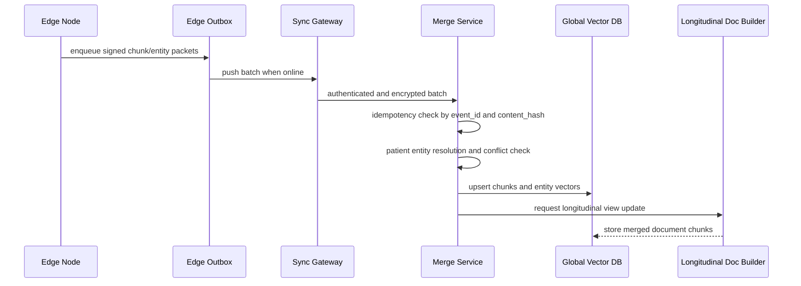

---

# 13. Central Merge Architecture

The central node should not blindly concatenate everything.

It must merge evidence.

---

## 13.1 Merge flow

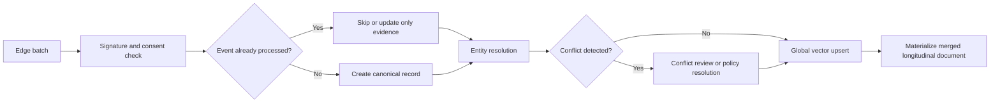

---

## 13.2 Merge rules

### For chunks

- Use `chunk_id` as primary id.
- Use `content_hash` to detect duplicates.
- If same chunk arrives again, do not duplicate.
- If chunk is corrected, mark old version `superseded`.

---

### For conditions

A condition should not be overwritten silently.

Example:

Node A says:

```json
{
  "display": "Asthma",
  "status": "active"
}
```

Node B says:

```json
{
  "display": "Asthma",
  "status": "resolved"
}
```

Do not simply pick the latest timestamp if clinical context is uncertain.

Instead:

- keep both evidence entries
- compute current status based on policy
- if conflict is high-risk, mark `conflict_review_required`

Possible policy:

```text
If status conflict exists:
  if one source is clinician-verified and newer:
      use clinician-verified status
  else:
      mark conflict and keep both evidence entries
```

---

### For medications

Merge by:

- medication name
- dose
- route
- frequency
- status
- start/end date

Do not merge if dose or route differs. Treat as separate evidence unless verified.

---

### For image findings

Merge by:

- anatomical site
- laterality
- label
- image region
- timepoint
- source document

Do not merge findings from different timepoints as if they are the same finding.

---

# 14. Patient Identity and Pseudonymization

This is one of the hardest parts.

## 14.1 Edge-local pseudonymization

At each edge node:

```text
patient_ref_id = HMAC(local_patient_id, edge_site_secret)
```

This avoids sending raw identifiers.

But if you need one global patient view across sites, you need one of:

1. trusted token vault
2. privacy-preserving patient matching
3. explicit master patient index
4. human-approved linkage

Do not do fuzzy patient merging by default without governance.

---

## 14.2 Recommended conservative approach

Use:

```text
tenant_id + site_patient_pseudonym
```

If cross-site merge is allowed:

- use a trusted linkage service
- store the mapping separately from clinical vectors
- require audit and access control
- log every linkage event

---

# 15. Merged Longitudinal Patient Document

You asked for the main node to give you a whole merged document, possibly broken into chunks but with the same schema.

This is the **Longitudinal Patient Document**, LPD.

---

## 15.1 What it contains

The LPD is not a raw concatenation.

It is a materialized view built from:

- condition entities
- medication entities
- observation entities
- findings
- evidence chunks
- provenance
- conflict flags

---

## 15.2 LPD schema example

```json
{
  "patient_ref_id": "pseudonym_abc",
  "doc_type": "longitudinal_patient_view",
  "schema_version": "1.0.0",
  "generated_at": "2026-01-01T12:00:00Z",
  "sections": [
    {
      "section": "conditions",
      "items": [
        {
          "condition_id": "cond_567",
          "display": "Type 2 diabetes mellitus",
          "status": "active",
          "certainty": 0.92,
          "first_seen_at": "2025-11-02T08:00:00Z",
          "last_seen_at": "2026-01-01T10:00:00Z",
          "evidence": [
            {
              "chunk_id": "doc_123::chunk_002",
              "node_id": "node_45",
              "confidence": 0.92
            },
            {
              "chunk_id": "doc_987::chunk_011",
              "node_id": "node_77",
              "confidence": 0.89
            }
          ]
        }
      ]
    },
    {
      "section": "medications",
      "items": [
        {
          "medication_id": "med_123",
          "display": "Metformin",
          "dose": "500 mg",
          "frequency": "twice daily",
          "status": "active",
          "evidence": [
            {
              "chunk_id": "doc_123::chunk_005",
              "node_id": "node_45",
              "confidence": 0.95
            }
          ]
        }
      ]
    },
    {
      "section": "evidence_chunks",
      "items": [
        {
          "chunk_id": "doc_123::chunk_002",
          "section": "history_of_present_illness",
          "text": "Patient has a history of type 2 diabetes.",
          "source_doc_id": "doc_123",
          "node_id": "node_45"
        }
      ]
    }
  ]
}
```

---

## 15.3 LPD chunking

The longitudinal document itself should be chunked and embedded.

Example:

```json
{
  "chunk_id": "lpd::pseudonym_abc::conditions::001",
  "doc_id": "lpd_pseudonym_abc",
  "patient_ref_id": "pseudonym_abc",
  "section": "conditions",
  "modality": "merged_text",
  "origin": "central_longitudinal_builder",
  "text": "Active conditions include Type 2 diabetes mellitus. Evidence from node_45 and node_77.",
  "source_chunk_ids": [
    "doc_123::chunk_002",
    "doc_987::chunk_011"
  ],
  "schema_version": "1.0.0"
}
```

This gives you:

- merged view
- chunk-level retrieval
- same schema
- provenance back to edge nodes

---

# 16. Chunk Lifecycle State Machine

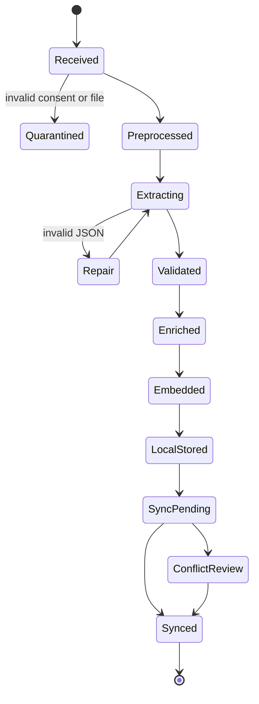

---

# 17. Query and RAG Architecture

Once vectors are in the global DB, you can use them for:

- patient condition search
- semantic note retrieval
- evidence lookup
- RAG over a patient longitudinal record
- similar finding retrieval
- audit search

---

## 17.1 Query flow

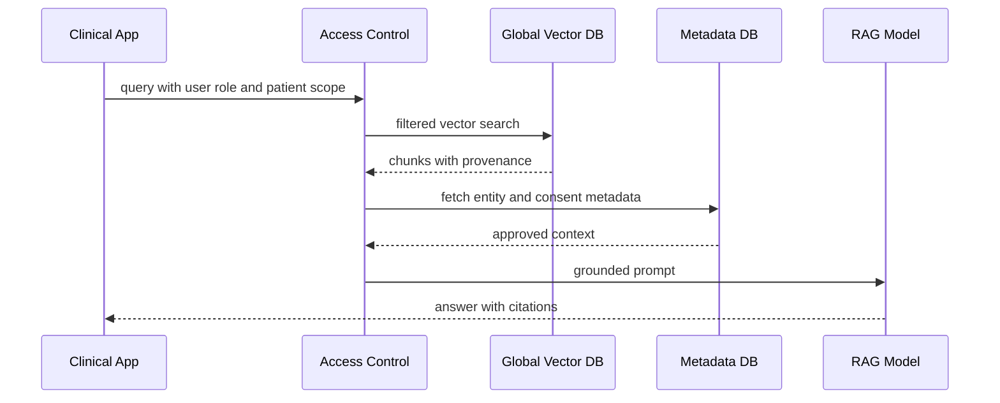

---

## 17.2 Example vector search filter

```json
{
  "filter": {
    "patient_ref_id": "pseudonym_abc",
    "tenant_id": "tenant_1",
    "consent_scope": "clinical_care_internal",
    "status": "active",
    "section": [
      "conditions",
      "assessment",
      "history_of_present_illness"
    ]
  },
  "query": "diabetes complications or worsening symptoms",
  "top_k": 20
}
```

---

# 18. Security, Privacy, and Compliance Design

This is essential for patient data.

---

## 18.1 Data minimization

Prefer sending to central node:

- pseudonymous IDs
- extracted structured entities
- vector embeddings
- redacted text chunks
- provenance metadata

Do not centralize raw identifiers unless required and approved.

---

## 18.2 Image handling

For photos:

- strip EXIF
- detect faces
- blur faces if identity not needed
- remove visible IDs
- store raw image edge-only if possible
- send only derived features or redacted references centrally

---

## 18.3 Access control

Vector DB must support metadata filtering and RBAC.

Required filters:

- `tenant_id`
- `patient_ref_id`
- `consent_scope`
- `node_id`
- `data_classification`
- `status`

---

## 18.4 Audit log

Every action should be logged:

```json
{
  "audit_id": "aud_123",
  "action": "vector_upsert",
  "actor": "edge_node_45",
  "patient_ref_id": "pseudonym_abc",
  "record_type": "chunk",
  "record_id": "doc_123::chunk_001",
  "model_version": "muse_glimmer_v1",
  "prompt_version": "extract_v7",
  "timestamp": "2026-01-01T10:00:00Z"
}
```

---

## 18.5 Deletion and right to be forgotten

You need:

- delete by patient_ref
- delete by doc_id
- delete by node_id
- delete by consent withdrawal
- cryptographic deletion where applicable
- reindex after deletion
- deletion audit record

---

# 19. Reliability and Failure Handling

## 19.1 Edge failure modes

| Failure | Handling |
|---|---|
| GPU unavailable | Queue jobs, degrade to smaller model if approved |
| Model timeout | Retry, then dead-letter queue |
| Invalid JSON | Repair agent, then human review |
| Local vector DB down | Write-ahead log, replay later |
| Network down | Store-and-forward outbox |
| Consent missing | Quarantine |

---

## 19.2 Central failure modes

| Failure | Handling |
|---|---|
| Sync gateway down | Edge retries with backoff |
| Duplicate event | Idempotency check |
| Schema mismatch | Reject event to dead-letter queue |
| Conflict | Conflict review queue |
| Vector DB overload | Batch ingestion, backpressure, quantization |

---

# 20. Observability

You need end-to-end traceability.

## 20.1 Trace fields

Every record should include:

```json
{
  "trace_id": "trace_abc",
  "run_id": "run_123",
  "node_id": "node_45",
  "model_route": "qwen_3_8_27b",
  "model_version": "v1.2",
  "prompt_version": "v7",
  "schema_version": "1.0.0"
}
```

---

## 20.2 Metrics to monitor

| Metric | Why important |
|---|---|
| Extraction latency | GPU bottleneck detection |
| Schema validation failure rate | Prompt or schema drift |
| Human review rate | Model confidence/quality |
| Sync lag | Edge connectivity health |
| Duplicate event rate | Retry/idempotency health |
| Vector DB query latency | Search performance |
| Conflict rate | Data quality issue |
| Consent rejection rate | Privacy governance |

---

# 21. Evaluation Strategy

You cannot run this safely without evaluation.

## 21.1 Golden set

Create a golden dataset with:

- text notes
- photos
- scanned forms
- known expected conditions
- known expected medications
- known negative cases
- tricky edge cases

---

## 21.2 Evaluation metrics

| Metric | Meaning |
|---|---|
| Precision | How many extracted entities are correct |
| Recall | How many true entities were found |
| Evidence correctness | Does evidence support the extracted fact |
| Schema validity | Does output follow schema |
| Hallucination rate | Invented facts |
| Conflict accuracy | Correct merge behavior |
| Retrieval recall | Are correct chunks found during search |

---

# 22. Acceptance Criteria

## 22.1 Ingestion

- Given a valid text or photo, the system creates a run envelope.
- Given missing consent, the artifact is quarantined.

## 22.2 Extraction

- Given a valid clinical note, the system extracts structured entities.
- Every extracted condition must include evidence or be marked uncertain.
- JSON output must pass schema validation.

## 22.3 Vectorization

- Every approved chunk has an embedding.
- Every vector has patient_ref, tenant_id, node_id, schema_version, and content_hash.

## 22.4 Sync

- If edge node goes offline, events remain in outbox.
- When online, all queued events sync.
- Duplicate events do not create duplicate vectors.

## 22.5 Merge

- Central node merges multiple evidence entries for same condition.
- Conflicting statuses create conflict flag unless policy resolves them.
- Merged longitudinal document uses same schema as source chunks.

## 22.6 Query

- Authorized query returns only patient-scoped and consent-approved chunks.
- Retrieved chunks include provenance.
- RAG output cites chunks and does not invent facts.

---

# 23. Recommended Implementation Phases

## Phase 1: Schema and single-node MVP

Goal: prove the agentic extraction loop.

Deliver:

- canonical schema
- text-only ingestion
- one model route
- local vector DB
- human review queue

---

## Phase 2: Multimodal extraction

Goal: support photos and scanned documents.

Deliver:

- OCR
- vision preprocessing
- Qwen 3.8 27B route
- image finding schema
- redaction pipeline

---

## Phase 3: Multi-model router

Goal: support Muse Glimmer, Gemma 4 31B, and Qwen 3.8 27B.

Deliver:

- model router
- fallback logic
- GPU scheduling
- ensemble/critic mode
- model evaluation dashboard

---

## Phase 4: Edge fleet sync

Goal: support hundreds of nodes.

Deliver:

- outbox pattern
- signed sync batches
- idempotent central ingestion
- node health monitoring
- backpressure and retries

---

## Phase 5: Central merge and longitudinal document

Goal: produce merged patient view.

Deliver:

- entity resolution
- conflict resolution
- longitudinal document builder
- merged chunk embeddings
- audit trail

---

## Phase 6: Production hardening

Deliver:

- consent enforcement
- deletion workflow
- RBAC
- observability
- golden-set regression
- security review
- clinical safety review

---

# 24. Recommended Data Flow Summary

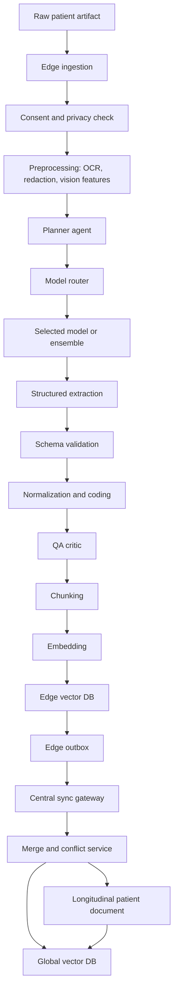
